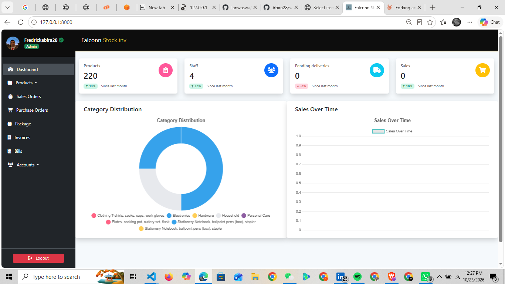
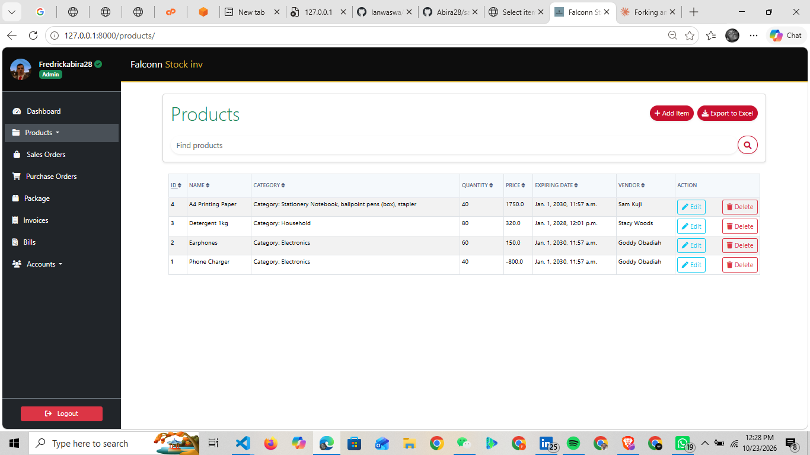
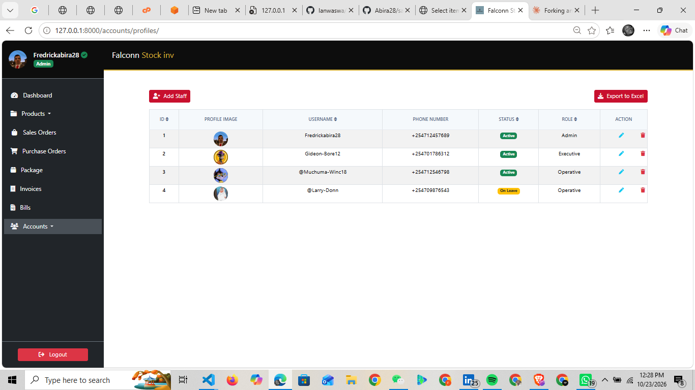

# Falconn Stock Inv

A sales and inventory management system built with Django. It helps a small business keep track of products, vendors, purchases, sales, invoices and bills, and lets staff work from their own accounts with different roles.

This is my customised version of an open-source project. See [Credits](#credits) below.

## Screenshots

> Add your screenshots to a `docs/screenshots/` folder and update these paths.

| Dashboard | Products |
|---|---|
|  |  |

| Staff |
|---|
|  |

## Features

- **Products and categories:** add items with a description, category, quantity, price, expiry date and vendor
- **Vendors:** store supplier names, phone numbers and addresses
- **Sales and purchase orders:** record what is sold and what is bought
- **Invoices and bills:** generate and keep billing records
- **Staff accounts:** each person has a profile with a picture, phone number, email, status (Active, Inactive, On leave) and role (Operative, Executive, Admin)
- **Search and sorting** on the product and staff tables
- **Export to Excel** from the product and staff pages
- **Django admin panel** for managing all data

## What I changed

- Rebranded the interface as **Falconn Stock Inv**, with a black, red and gold theme
- Switched the database from PostgreSQL to **SQLite** so it runs locally with no extra setup
- Set up media handling so profile pictures upload and display correctly
- Moved the secret key and debug setting to environment variables, and removed the original deployment details
- Added sample vendors, categories, products and staff for testing

## Built with

- Python and Django 5.1
- SQLite
- Bootstrap and custom CSS
- Django admin

## Getting started

### Requirements

- Python 3.11 or newer
- Git

### Installation

```bash
git clone https://github.com/Abira28/sales-and-inventory-management.git
cd sales-and-inventory-management
git checkout my-version
```

Create and activate a virtual environment.

On Windows:

```bash
python -m venv venv
venv\Scripts\activate
```

On macOS or Linux:

```bash
python3 -m venv venv
source venv/bin/activate
```

Install the packages and set up the database:

```bash
pip install -r requirements.txt
python manage.py migrate
python manage.py createsuperuser
```

### Default profile picture

New profiles use `media/profile_pics/default.jpg`. The `media/` folder is not stored in Git, so create the folder and put any square image named `default.jpg` inside it:

```
media/
  profile_pics/
    default.jpg
```

### Run the app

```bash
python manage.py runserver
```

Then open:

- The app: http://127.0.0.1:8000
- The admin panel: http://127.0.0.1:8000/admin/

### Settings

These can be set as environment variables. The defaults suit local development only.

| Variable | Default | Purpose |
|---|---|---|
| `SECRET_KEY` | a local development key | Django secret key. Always set your own in production. |
| `DEBUG` | `True` | Set to `False` in production. |

If you deploy the app, also add your domain to `ALLOWED_HOSTS` in `InventoryMS/settings.py`.

## Project structure

| Folder | Purpose |
|---|---|
| `InventoryMS/` | Project settings and main URLs |
| `accounts/` | Staff profiles, roles and vendors |
| `store/` | Products, categories and deliveries |
| `transactions/` | Sales and purchases |
| `invoice/` | Invoices |
| `bills/` | Bills |
| `static/` | CSS, JavaScript and images |

## Credits

This project is a fork of [lanwaswa/sales-and-inventory-management](https://github.com/lanwaswa/sales-and-inventory-management). All credit for the original application goes to its author. My changes are listed under [What I changed](#what-i-changed).

## License

This project keeps the license of the original work. See the [LICENSE](LICENSE) file for details.